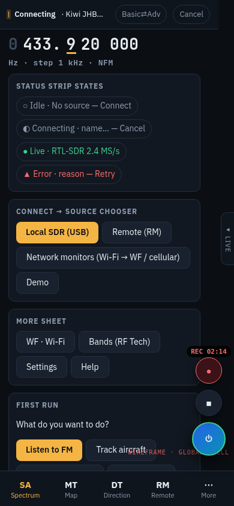
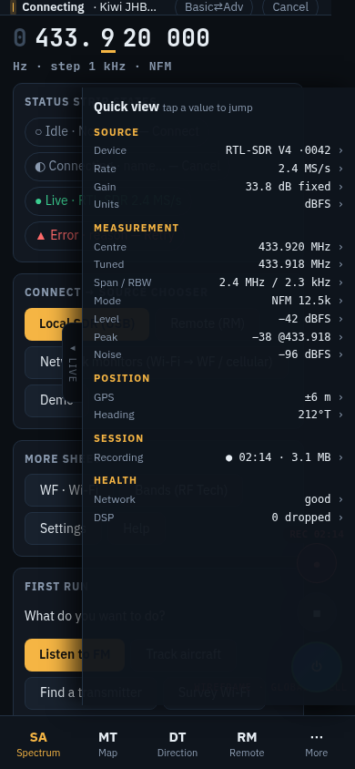
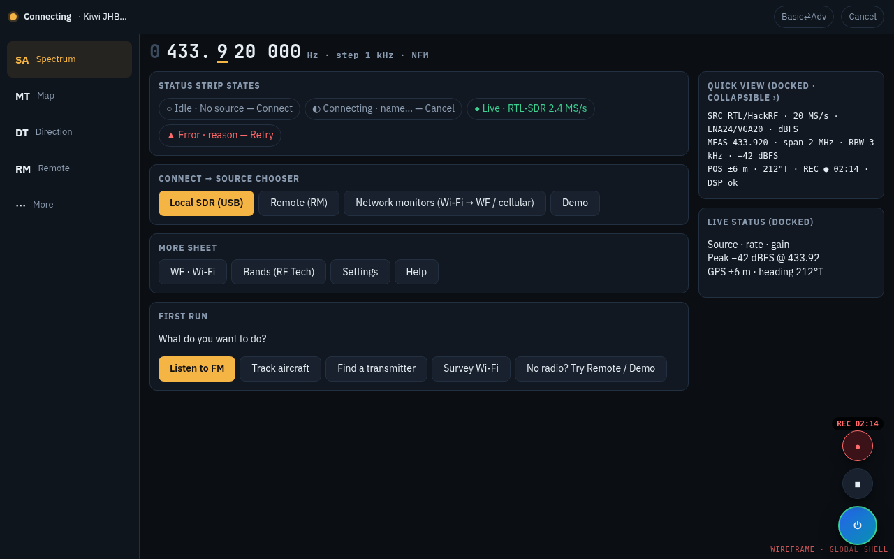
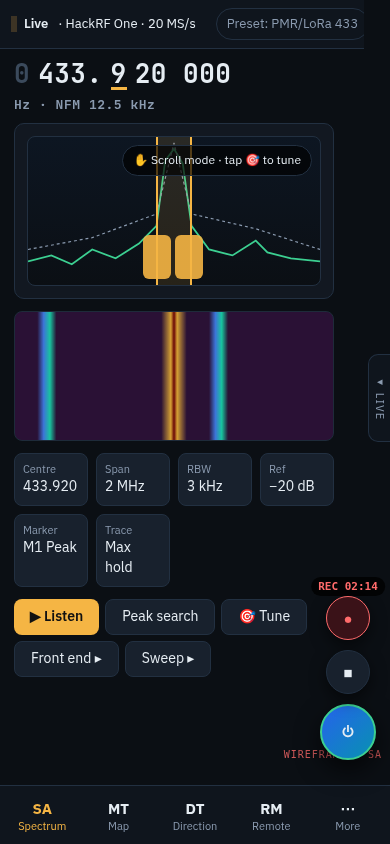
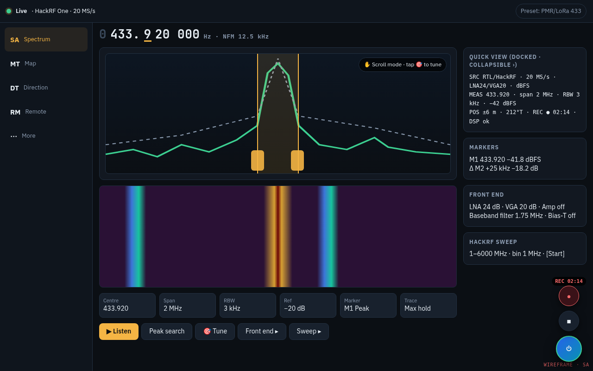
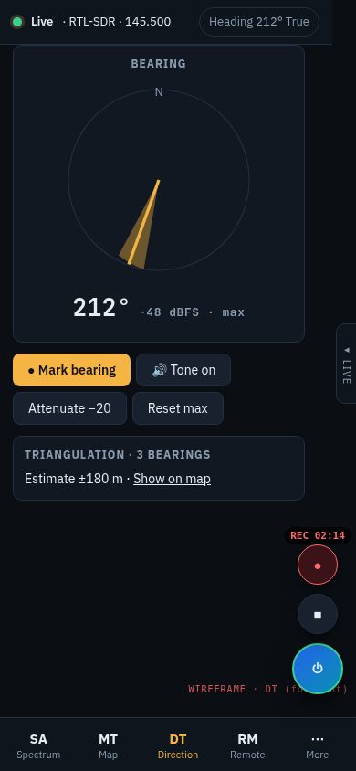
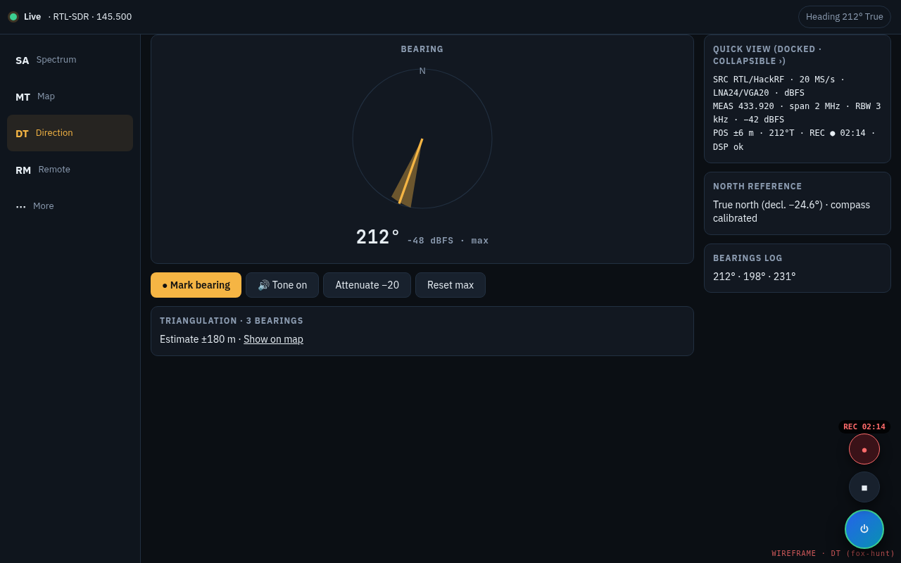
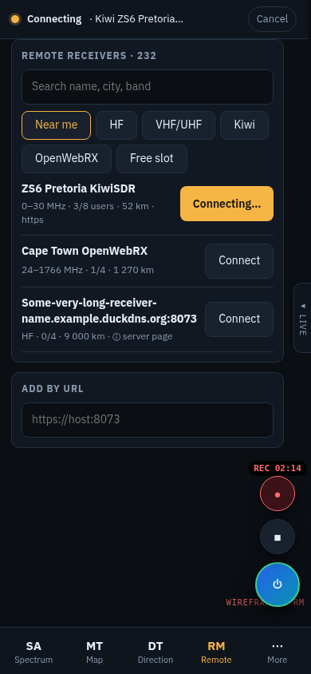
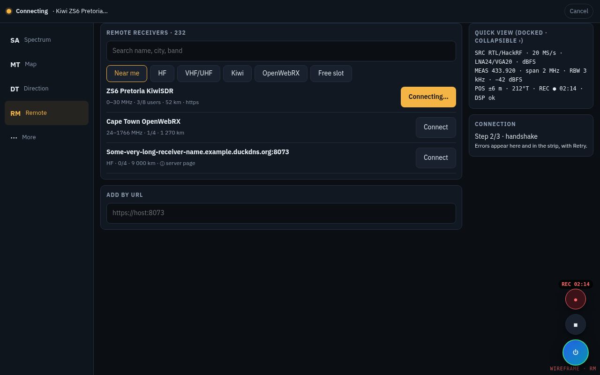

# webRx layout proposal (joint)
Authors: **Spectra** (RF/SDR lead) + **UI Designer & Tester**. For Lee McQuire. Proposal only: no app code, branches or PRs changed.
Sources: `rf-notes.md`, `ui-notes.md`; audited against main d98ea53, PR #10 `rf-tab-improvements`, PR #11 `dt-df-overhaul` (clone `/workspace/webrx-layout-src`). Mockups: `ux/mockups/` (390×844 mobile, 1280×800 desktop; HTML beside each PNG).

**Already implemented in open PRs (not merged):** PR #10 = WF tab (4 sub-tabs) and RF tab fixes. PR #11 = DT overhaul (bearing maths, true north, triangulation, tone, sessions/export/share) and HackRF LNA/VGA/amp, baseband filter, RTL AGC, hardware info and sweep. This proposal *places* those features.

**Parity guarantee:** every current control, setting, gesture, storage value and link keeps a home (Appendix A: 199 control ids, 0 dropped). The only item removed is the orphaned storage key `webrx.avgMode` (A.4).

## 1. Global shell
  
*Shell, SA, RM and DT mockups were regenerated at 06:30 on 13 Oct. They show the bar without a WF slot, the **bottom-right FAB cluster** (Connect + Stop + Record), the **"◂ LIVE" edge tab** with the quick-view panel (opened in `shell-panel-390.png`, docked on desktop), the source chooser and the More sheet. The SA mockup still shows 6 soft-keys; the final set is 7.*

### 1.1 Navigation
| | Mobile (<900 px) | Desktop (≥900 px) |
|---|---|---|
| Primary | bottom bar **SA · MT · DT · CM · RM · More** (6 × 60 px at 360 px, icon over label, roving tablist) | 200 px left rail: SA, MT, DT, CM, RM |
| More | sheet: **WF (Wi-Fi) · Bands (RF Tech) · Settings · Help** | separator + "More" group in the rail: WF, Bands, Settings, Help (all one click) |
| Right side | — | 280 px docked status/inspector column |
Entry points into WF besides More: the Bands Wi-Fi rows ("Open in WF"), the source chooser "Network monitors → Wi-Fi monitor", the Wi-Fi survey preset, and `#wf`/`#wifi`.

### 1.2 Status strip (status only)
- **Where:** a slim, sticky, in-flow line (`role=status`) on every tab.
- **Shows:** state dot + source · rate · preset · unit badge.
- **States:**
  - Idle ○ "No source"
  - Connecting ◐ + Cancel
  - Live ●
  - Error ▲ with a plain reason + Retry
  - Reconnecting ↻ n/5 (remote)
- **No buttons except Cancel/Retry.** Tapping the strip opens the same **source chooser** as the FAB.
- **Height:** strip + readout ≤96 px at 390 px wide.
- **Ticker:** dropped; the quick-view panel (§1.2b) carries the at-a-glance values instead.

### 1.2a Bottom-right FAB cluster (every tab; keeps every function of today's `connBubble`)
**Today's FAB, inventoried** from thesis-view.html (main, PR #10 and PR #11 are identical here), CSS ~l.368–381/405–442/588, JS ~l.1761–1791, and monitor.ts `bind`/`updateButtons`/`onConnectClick`:
| Aspect | Today |
|---|---|
| Element | `<button class=bubble id=connBubble aria-haspopup=dialog aria-controls=connSheet>` with a plug icon (`#i-plug`) and a status dot `bubbleDot` |
| Tap | opens the **Connection sheet** `connSheet` (modal). The same sheet is opened by the header chip `connChip` and Settings `btnOpenConn` |
| Long-press / other gestures | **none** |
| Look | 56 px circle, blue→cyan gradient, white icon, shadow, press scale 0.94. **Night theme** = red `#991b1b`. Landscape short screens (≤500 px high) = 48 px, moved to the corner |
| States (dot top-right, mirrored from `dotSource`) | idle grey `#64748b` · `ok` green · `warn` amber · `err` red · `live` green **pulsing**, and the FAB gets a green glow ring. aria-label = "Connection: <status text>" |
| Position | `right: 16 px + safe-area`, `bottom: nav-h + safe-area + 16 px`; **`body.playing` raises it +120 px** above the playback bar |
| Desktop | **hidden at ≥1000 px** (`.bubble{display:none}`); the header `connChip` takes over |
| Sheet contents | ① status dot + text (`sheetDot`/`sheetTxt`) ② **Source select** `sourceSelect`: Auto RTL-SDR/HackRF · RTL-SDR · HackRF · Wi-Fi signal monitor · Cellular monitor (changing it stops, disconnects, saves `cfg.mode`, logs) ③ device hint `sourceHint` (name, serial, range) ④ **Connect ⇄ Disconnect** `btnConnect` (label follows device state; disabled while running without a device) ⑤ chips GPS (tap → MT), Network, DSP (`sheetChips`) ⑥ ✕ / backdrop / Esc close |
| Related | header `recPill` "LIVE" while running; Start/Stop/Rec live in the header |

**Merged design: old muscle memory first, then new functions.**
| Interaction | Proposed | Old behaviour kept? |
|---|---|---|
| **Tap FAB** | opens the **same Connection sheet**, now laid out as the source chooser: **Local SDR** (Auto/RTL-SDR/HackRF = old `sourceSelect` SDR options, with hint, Connect⇄Disconnect) · **Remote** (recent servers + "Browse RM") · **Network monitors** (Wi-Fi → also "Open WF", Cellular) · **Demo**. Status line and GPS/Network/DSP chips on top as today; GPS chip → MT | ✓ identical gesture and result; the select becomes 4 segments with the same options, last choice pre-selected |
| Long-press FAB (optional, new) | quick **Connect/Disconnect** of the last source without opening the sheet (haptic + toast) | additive; it never replaces the tap |
| Dot + ring | same 5 states/colours; live = pulse + green ring; **new:** Reconnecting ↻ amber spinner for remote | ✓ |
| aria-label | "Connection: <status>" | ✓ |
| Night theme | red FAB | ✓ |
| Start/Stop mini (44 px, above FAB) | ▶ ⇄ ■ (`btnStart`/`btnStop`), disabled when no source; mirrors the header `recPill` LIVE state | new placement; header buttons were 1 tap → still 1 tap |
| Record mini (44 px, top) | ● `btnRec`; red + REC mm:ss timer while recording; popover with size/limits | new placement, same 1 tap |
| Playback offset | the whole cluster rises +120 px while `body.playing` | ✓ |
| Landscape short screens | 48 px FAB, minis 40 px, cluster stays in the corner | ✓ |
| Desktop | **now shown** (bottom-right at the foot of the docked quick-view column); `connChip` in the strip still opens the same sheet | changed on purpose (user decision); the chip path is kept |
| No-overlap | pane `padding-bottom ≈ 180 px + nav + safe-area` (last row always clears the cluster); on mobile the Start/Record minis fade out while the page is scrolling and return 0.9 s after it stops; on desktop the cluster sits left of the docked quick view | fixes the B7 and Clear-fixes overlaps |

### 1.2b Quick-view side panel (keeps today's `statusPanel` + `spToggle` "Live" edge tab)
**Today (PR #11 build):** `<aside id=statusPanel>` with a 44×88 px "Live" edge tab `spToggle`. The tab opens it on tap; there is **no swipe gesture in code today** (`bindStatus`, monitor.ts ~l.3010). Its open state is saved in `webrx.status.open`. It slides in by `translateX` and is docked at ≥1280 px (CSS ~l.592–606).

It shows:
- `spCentre` Centre
- `spTuned` Tuned
- `spSpan` Span (BW)
- `spRbw` RBW/FFT
- `spRate` Sample rate
- `spGain` Gain/amp
- `spMode` Modulation
- `spLevel` Level
- `spPeak` Peak
- `spFloor` Noise floor
- `spGps` GPS
- `spHeading` Heading
- `spRec` Recording
- `spDevice` Device
- network chip `chipNet`/`txtNet`
- DSP chip `chipDsp`/`txtDsp`

The values refresh every 1 s.

**Proposal: keep it, regrouped:**
| Group | Fields (every current field kept) |
|---|---|
| Source | Device `spDevice` (+ serial/firmware), Sample rate `spRate`, Gain/amp `spGain` (LNA/VGA/amp or RTL gain/AGC), units badge |
| Measurement | Centre `spCentre`, Tuned `spTuned`, Span `spSpan`, RBW/FFT `spRbw` (+ VBW/detector), Modulation `spMode`, Level `spLevel`, Peak `spPeak`, Noise `spFloor` |
| Position | GPS `spGps`, Heading `spHeading` (°T/°M) |
| Session | Recording `spRec` (time/size/limits), playback state |
| Health | Network `chipNet`, DSP `chipDsp`, dropped frames, remote reconnect n/5 |
- **Tap-to-jump:** each value links to its owning control (Gain → SA AMPL, Heading → DT North reference, Recording → Settings Recording, …).
- **Open/close:**
  - tap the edge tab (kept)
  - **new:** swipe left from the right screen edge to open, swipe right on the panel to close
  - Esc closes
  - the state is remembered in `webrx.status.open`
- **Edge tab sizing:**
  - narrowed to 22–24 px visible (44 px hit area), at ~42 % height
  - every mobile pane gets `padding-right: 28 px + safe-area-right`, so it never covers content (fixes earlier issue L4)
  - the edge-swipe zone is the 16 px strip at the screen edge and doesn't steal pans inside the spectrum
- **Mobile:** an overlay of ≤300 px / 78 % width, closed by default.
- **Desktop (≥900 px):** a docked 280 px column at the top of the right side, collapsible to the edge tab. Contextual cards (Markers, MEAS, Sweep, DT bearings log) sit below it, and the FAB cluster sits at its foot.

### 1.3 Frequency model (no merge losses)
| Quantity | Meaning | Where shown/edited |
|---|---|---|
| **Tuned** | demod/listen frequency (`vfoInput`, `tuneFreq`, `rxFreq` when remote) | shared readout on SA/DT/MT; Listen strip |
| **View** | SA display centre/span/start/stop/pan (`saCentre`, `saStart`, `saStop`, `saPan`, `saZoom`); can differ from tuned | SA FREQ sheet; "Centre on tuned" (`btnTuneCentre`, `btnScopeCentre`) |
| **DT target** | `dtFreq`: **Follow tuned** (default, as today when blank) or **Lock target** | DT target chip + DT sheet |
| **Start-up frequency** | Settings `freq` (+ `freqPresets`) | Settings → Receiver; the default preset can override it |
| **Per-source memory** | last tuned/mode/BW per source (local device serial, each remote URL) | automatic; restored on reconnect |

### 1.4 Disclosure, units, gestures
- **Disclosure:** 3 levels, Basic (default on first run) → Measure → Expert, remembered per device.
- **Units:** dBFS for local SDR; dBm only when calibrated or Kiwi; remote native units badged.
- **Gestures:**
  - **Spectrum:**
    - tap = tune, or place M1/M2 per `saTap`
    - horizontal drag pans after axis-lock; vertical swipes scroll the page (`pan-y`)
    - drag-to-retune only in 🎯 Tune mode
    - pinch/wheel = display zoom; double-tap resets
    - passband grips are draggable
    - existing keyboard keys unchanged
  - **Readout digits:** wheel over a digit kept. **Swipe-on-digit** becomes an opt-in Settings toggle, "Swipe digits to tune" (off by default).
  - **Desktop only:** Y-drag sets ref level; vertical floor/contrast sliders.

**Clickable demo:** `demo/webrx-new-ui-demo.html` (now with the CM tab and the RM survey wizard + run screen; screenshots `demo/demo-rm-390.png`, `demo/demo-rm-1280.png`) (single offline file, mock data marked DEMO; screenshots `demo/demo-390.png`, `demo/demo-1280.png`, `demo/demo-panel-390.png`).

## 2. Benchmarks → patterns adopted
| App | Layout pattern | Take for webRx |
|---|---|---|
| SDR++ | Left collapsible module sidebar (Source, Radio, Display, Recorder), big FFT+waterfall right, freq digits on top bar with scroll-to-tune | Collapsible SA side drawers on desktop; per-digit scroll tuning in freq bar |
| SDR# | Top toolbar (play, freq, mode), left plugin panels, zoom/contrast sliders on right edge of spectrum | Vertical range/contrast sliders beside the plot instead of form fields |
| GQRX | Docked tabs: Input ctl / Receiver / Audio / FFT settings; "Input controls" hold gain stages, ppm, DC/IQ fix | Group Settings' front-end items into an "Input" drawer |
| tinySA / RF Explorer | Hardware keys: FREQ, SPAN, AMPL, BW, MARKER, TRACE, PRESET menus; numeric entry with unit keys | Mobile SA bottom sheet with exactly these 7 soft-keys |
| Signal Hound Spike | Left "Sweep settings" panel: Center/Span, RBW/VBW (auto-coupled), Ref level, Div, Detector, Atten/Preamp; marker table under plot | Auto-coupled RBW/VBW with "Auto" toggle; marker table |
| R&S / Keysight | Hard-key menus, annotation of RBW/VBW/SWT/Att/Ref in plot corners, Channel Power/ACP measurement apps | Plot corner annotations; "Measure" menu (Channel power, OBW, Peak search) |
| OpenWebRX / KiwiSDR / UberSDR | Full-width waterfall, floating receiver panel (freq, mode buttons, squelch, vol), bookmarks on scale, server list with users/SNR/GPS | RM: map + list of servers; mode button row; bookmarks = band labels |
| SDR Touch / RF Analyzer (Android) | Full-screen spectrum, swipe to pan, pinch to zoom, single FAB menu, landscape-first | Mobile: plot ≥60% height, gestures, everything else in a bottom sheet |

## 3. Per-tab layouts
### SA — Spectrum analyser (home)
 
> Mockups show 6 soft-keys; **final set is 7: PRESET · FREQ · AMPL · BW · MARK · TRACE · MEAS**, each opening a bottom sheet (mobile) / inline panel (desktop).

| Zone | Mobile 390 | Desktop 1280 |
|---|---|---|
| 1 | strip, readout (`btnVfoDown/Up`, step chip `vfoStep`, mode/BW chip, level meter) | same, 32 px |
| 2 | spectrum ≈150 px, corner annotations | 260 px, Y-drag ref level |
| 3 | waterfall ≈130 px | 220 px + floor/contrast sliders |
| 4 | 7 soft-keys | 7-up row |
| 5 | **action row: ▶ Listen · Peak · ❄ Freeze · 🎯 Tune · Front end ▸ · Sweep ▸** | left drawer Front end; right column Markers/MEAS/Sweep |
| 6 | Listen strip (local and remote) | docked Listen panel |

**Sheets:**
- **PRESET:** presets, Recent, save current.
- **FREQ:** view centre/start/stop/pan/zoom (`saCentre`, `saStart`, `saStop`, `saPan`, `saZoom`, `btnSaZoomIn/Out`, `btnScopeZoomIn/Out`), Centre on tuned, step snap `saSnap`, band labels `saLabels`/`btnScopeLabels`.
- **AMPL:** ref `saRef`, range/dB-div `saRange`, auto `saAuto`, gain strategy `gain`/`gainAuto`, RTL AGC `rtlAgc`, HackRF `hrfLna`/`hrfVga`/`amp`, **Calibrate…** (wizard `cal*`). On mobile, waterfall floor/contrast also sit here.
- **BW:** FFT/RBW `saFft`/`fftSize`, VBW/averaging `saAvg`/`avg` (linear), detector, window.
- **MARK:** `btnM1Peak`, `btnM1Next`, `btnM2Delta`, `btnMTune`, `btnMClear`, zoom-to-M1 `btnSaZoomM1`, tap mode `saTap`.
- **TRACE:** `saTrace`, `saMax`, `saMin`, `saPeak`/`peakHold`, `saFill`, `saSmooth`, `saCmap`, `saWf`, `saWfFloor`, `saWfContrast`, Clear `btnSaClear`, Snapshot PNG `btnSaSnap`.
- **MEAS:** channel power `saChBw`, stats `saStats`, OBW, noise dBm/Hz.
- **Front end ▸:** sample rate `rate`, `hrfBaseband`, bias-tee `biasTee` (DC warning), direct sampling, ppm `fePpm`, upconverter `feUpconv`, DC remove `dcRemove`, hardware info (serial/firmware).
- **Sweep ▸:** `sweepLo`, `sweepHi`, bin width, `btnSweep`, max hold; result view `sweepCanvas` + peaks list `sweepPeaks` with "jump to SA".

**Listen sheet (from the Listen strip):** `btnAudio`, `vol`, `demodMode`, `demodBw` chip, **typed passband low/high edges (restored `pbLoIn`/`pbHiIn`)** + grips, `squelch`, `stereoChk`, de-emphasis `feDeemph`.

### MT — Mobile tracking
*No mockup yet (follow-up).*
- **Mobile:**
  - map ≈60 % with mini readout + level overlay
  - **compass chip** and GPS chip on the map header (`btnCompass`, `btnGPS`, `gpsSource` sheet)
  - **action row: ● Record · CSV `btnCSV` · Share `btnShare` · Snapshot `btnSnap` · Open map `btnOpenMap`**
  - peek sheet: Timeline → Sessions (`btnSessImport`/`sessFile`, list, **playback bar** `pb*`) → CSV recorder → Logging (`logMode`, `spacingM`, `logEvery`, `distFormula`, measurement BW `bwKHz`) → Calibration point (`btnCalibrate`, `needFix`) → Map tools (`btnMapCentre`, `btnMapFit`, `btnMapClear`, `btnClear`)
- **Desktop:** map centre; right column holds the same groups.
- Points are stamped with frequency, RBW and unit.

### DT — Direction finding
 
| Zone | Mobile | Desktop |
|---|---|---|
| Strip extras | heading °T/°M chip, calibration warning, target chip "Follows tuned / 🔒 433.920" | same |
| Meter | live level bar + peak hold, SNR `dtSnr`, gain `dtGain`, overload `dtOverload`, warnings `dtWarn` | left |
| Polar | lobe centre ± beamwidth (`dtBeam`), bearing, best `dtBest` | left |
| **Action row** | **● Mark `btnDtFix` · ⟳ Capture sweep `btnDtCapture` · 🔊 Tone `dtTone` · 🔒 Lock gain `btnDtLockGain` · 🔍 Find (→ SA Sweep, return button) `btnDtFind` · Reset `btnDtReset`** | toolbar |
| Triangulation | card `dtTriCard`/`dtEst`, heatmap toggle `dtHeat`, `btnDtFitMap`, `btnDtClearTrack`, `btnDtClearFixes` | right: map with cones + ellipse |
| Playback | session playback bar (shared component, as today on MT and DT) | bottom |

**DT sheets:**
- **Target & receiver:**
  - frequency `dtFreq` with Follow/Lock, bandwidth `dtBw`, source `dtSource`
  - mode peak/null `dtMode`, squelch `dtSquelch`
  - **antenna power** (bias-tee `dtBias`, mirrors SA `biasTee`)
- **North reference:**
  - declination auto (WMM)/manual (`dtDeclMode`, `dtDeclManual`)
  - mount offset `dtOffset`, manual heading `dtManual`, compass `btnDtCompass`
  - calibration hint `dtCalib`
  - **lag compensation `dtLag`**
- **Range estimate:** EIRP `dtEirp`, path-loss exponent `dtPlExp`, relative-level display `dtRelative`.
- **Field options:** **high-contrast sun theme `dtSun`**, haptics `dtHaptics`, hints `dtHints`.
- **Sessions & export:**
  - sessions: `dtSession`, `btnDtNewSession`, `btnDtDelSession`
  - export: CSV `btnDtExpCSV`, KML `btnDtExpKML`, GPX `btnDtExpGPX`, **JSON `btnDtExpJSON`**
  - **import `btnDtImport`/`dtImportFile`**, **Share link `btnDtShare` (`?dts=…#dt`)**

### CM — Connect reMote (renamed from RM; everything below unchanged)
 
- **Browser:**
  - search `rxSearch`, kind chips `rxKind`, sort `rxSort`, Only-OK `rxOnlyOk`
  - favourites/saved servers
  - rows with a 44 px Connect `btnRxConnect`
  - Add by URL (`rxUrl`, `rxUrlKind`)
- **Connected card:**
  - state, unit badge, reconnect n/5
  - users/time limit
  - **profile `rxProfile`**
  - **Open server page `btnRxOpen`/`rxOpenLink`**
  - Disconnect `btnRxDisconnect`
- **Listening:** `rxFreq`, `rxMode`, `rxSquelch`, `rxVol` and `btnRxAudio` are driven by the SA Listen strip, with a compact copy on the RM connected card so a user can listen without leaving RM.
- Optional server map on desktop.

### WF — Wi-Fi analyser (under More; PR #10)
*No mockup yet (follow-up).*
- **Layout:** sticky segmented control (`wfs-aps`, `wfs-rate`, `wfs-graph`, `wfs-time`) with band filter `wfBand` upfront.
- **AP rows:** SSID, channel, band, RSSI dBm.
- **Source:** source chip `wfSource`, connection card `wfConn`, demo toggle `wfDemo` (Advanced).
- **Desktop:** graph + table side by side.
- **"Show in SA" (HackRF sweep 2400–2500 MHz).**
- **Reached via:** More, Bands Wi-Fi rows, source chooser Wi-Fi monitor, Wi-Fi survey preset, `#wf`/`#wifi`.

### Bands (RF Tech, under More)
*No mockup yet (follow-up).*
- Sticky search; band tables `bandSet` with ≥44 px "Tune in SA" / "Open as preset"; coverage flags.
- **Wi-Fi rows → "Open in WF"** (`btnOpenWifi`).
- **Network quality** card (`btnRfWifi`, `btnRfCell`), labelled as network, not RF.

### Settings (under More)
*No mockup yet (follow-up).*
1. **Receiver summary (read-only):** source, rate, gain, FFT, cal state, bias-tee, start-up frequency `freq`. Each line links to its control (SA AMPL/BW/Front end, MT Logging). `freq` stays editable here.
2. **Recording:** `limMB`, `limMin`, `limFps`.
3. **Look & feel:**
   - `setTheme`, palette, `setDensity`, `setMotion`
   - disclosure level
   - **Swipe digits to tune**
   - sun/high-contrast (shared with DT `dtSun`)
4. **Start-up:** `setStartTab` options **Last · SA · MT · DT · RM · WF · Bands**, plus the default preset.
5. **Location:** GPS source, declination default (mirrors DT).
6. **App:** `btnInstall`, Run setup again, Help, system log.

Whole label rows are ≥44 px.

### Quick-view panel (status)
See §1.2b. It's kept as the swipe/edge-tab slide-out on mobile and the docked collapsible column on desktop, with 5 groups and tap-to-jump. Every current field is kept.

## 4. What moves where
| Item | Now | Proposed |
|---|---|---|
| `connBubble` | floating FAB, bottom-right | **kept** as the Connect FAB (also on desktop); opens the source chooser |
| `connChip`/`sourceSelect`/`btnConnect`/`btnOpenConn` | header chip + sheet | strip tap / FAB → source chooser (Local / Remote / Network monitors / Demo) |
| `btnStart`/`btnStop`/`btnRec` | header | **FAB cluster** minis (Start⇄Stop, Record with timer), every tab |
| `statusPanel`/`spToggle` | slide-out "Live" panel + edge tab; docked ≥1280 | **kept**: grouped, tap-to-jump, slimmer edge tab, + edge swipe; docked ≥900 |
| Tabs | 7 in one bar | mobile SA·MT·DT·CM·RM·More (WF, Bands, Settings, Help); desktop rail with More group. Old RM (remote) → **CM**; new **RM = Recording/Monitoring survey** (§11) |
| Frequency inputs | 6 separate | tuned readout + SA view + DT follow/lock + start-up freq + per-source memory |
| Settings receiver (`rate`, `fftSize`, `avg`, `gain`, `gainAuto`, `amp`, `biasTee`, `dcRemove`, `peakHold`, `rtlAgc`, `cal`) | Settings | SA sheets (contextual) + read-only summary in Settings |
| `bwKHz`, logging rules | Settings | MT Logging |
| Tuner card `feUpconv`/`fePpm`/`feDeemph` | SA | Front end ▸ / Listen sheet |
| `pbLoIn`/`pbHiIn` (removed in PR #11) | — | restored in Listen sheet |
| `btnCompass`/GPS | MT card | MT map-header chips + strip GPS chip; DT has its own compass control |
| `rxFreq`/`rxMode`/`rxSquelch`/`rxVol`/`btnRxAudio` | RM | SA Listen strip + compact copy on RM card |
| WF | top tab | More → WF |
| RF Tech | top tab | More → Bands |
| HackRF/sweep (PR #11) | SA sections | AMPL / Front end ▸ / Sweep ▸ |
| `btnSaFreeze` | display section | SA action row |
| `btnDtCapture`/`btnDtFind`/`btnDtLockGain` | DT cards | DT action row |
| `btnCSV`/`btnShare`/`btnSnap`/`btnOpenMap` | MT card | MT action row |

## 5. Presets (RF values are authoritative)
Fields: centre, span, RBW, VBW/avg, mode, IF BW, gain strategy, device/source, display extras. "Gain strategy": **AGC** (listening), **Fixed-mid** (measurement, RTL 28–33 dB / HackRF LNA 24 VGA 20 amp off), **Fixed-low** (DF/close range). RBW assumes auto-coupling (span/~1000 bins).
| Preset | Centre | Span | RBW | Mode / IF BW | Gain | Device | Notes |
|---|---|---|---|---|---|---|---|
| FM broadcast | 98.0 MHz | 20.48 MHz (87.5–108; RTL 2.4 MHz Live → use HackRF or Sweep) | 10 kHz | WFM 200 kHz, stereo, 50 µs de-emph (ZA) | AGC | RTL/HackRF | band labels on |
| Airband | 127.5 MHz | 18 MHz (118–137) ; RTL 2.4 MHz @121.5 | 3 kHz | AM, **25 kHz step default (8.33 kHz option)**, 8 kHz IF BW, squelch on | Fixed-mid | RTL | 121.5 guard marker |
| ADS-B 1090 | 1090 MHz | 2 MHz | 10 kHz | none (pulse) – show "use decoder" | Fixed max (RTL 49.6 / HackRF LNA 40 VGA 30 amp on) | RTL/HackRF | peak detector, max hold |
| 2 m ham | 145.0 MHz | 2.4 MHz (144–146) | 2 kHz | NFM 12.5 kHz | Fixed-mid | RTL | 145.500 calling marker |
| PMR446 | 446.1 MHz | 200 kHz | 1 kHz | NFM 12.5 kHz, CTCSS-free squelch | Fixed-mid | RTL | 16 ch markers 446.00625+12.5k·n |
| LoRa/ISM 433 | 433.92 MHz | 2 MHz (433.05–434.79) | 5 kHz | NFM/raw 200 kHz, peak detector, max hold | Fixed-mid | RTL | burst-friendly: waterfall fast |
| NOAA APT | 137.5 MHz | 2 MHz (137.0–138.0) | 1 kHz | WFM 38 kHz, no de-emph | Fixed-mid, bias-tee prompt | RTL | marks 137.100/.620/.9125; pass predictor link |
| Cellular bands (ZA) | B20 806 / B8 942.5 / B3 1842.5 / B1 2140 / B7 2655 MHz | per-band DL width (e.g. B3 75 MHz) | 100 kHz | none; RMS detector, Channel power | Fixed-mid | HackRF (Sweep); RTL ≤1766 only | channel power + OBW |
| Wi-Fi survey | 2442 MHz | 100 MHz (2400–2500) Sweep; 5 GHz 5150–5850 | 100 kHz | none; Peak + Max hold | Fixed-mid, amp off | HackRF (Sweep) + WF tab AP list | link to WF |
| Fox-hunt DF | user freq (default 145.5 MHz) | 100 kHz | 1 kHz | NFM 12.5 kHz, audio tone on | **Fixed-low, AGC off**, attenuator hint | RTL/HackRF | opens DT |
| HF via Kiwi | 7.1 MHz (40 m) | 30 MHz overview → 200 kHz zoom | server-defined | LSB 2.7 kHz (USB ≥10 MHz) | server AGC | Remote Kiwi/UberSDR | units dBm badge |
| Wideband sweep | 1 GHz | 1–6000 MHz | 1 MHz | none; Peak detector, max hold | Fixed-mid, amp off | HackRF Sweep (RTL: 24–1766 stepped) | "Find signal" target |
Rules: preset never silently changes device; if device can't cover it, show "Needs HackRF/Remote" with alternative. User presets = save current state. Band-table rows in RF Tech can spawn a preset.

**Home tab per preset:**
- **FM:** SA (Listen, station peaks, stereo/RDS).
- **Airband:** SA (AM, squelch, step chip, scan list).
- **ADS-B:** SA spectrum/burst view only (see RF answer 9).
- **2 m:** SA (NFM/SSB, repeater offset ±600 kHz).
- **PMR/LoRa:** SA (max hold, channel chips).
- **NOAA:** SA.
- **Cellular:** Bands → SA (Ref/RBW upfront, measurement-only notice).
- **Wi-Fi survey:** opens **WF** (More → WF; also `#wf`).
- **Fox-hunt:** DT.
- **HF via Kiwi:** RM → SA.
- **Wideband sweep:** SA Sweep.

## 6. Beginner flow
1. **First screen (Source):** Local SDR (USB) · **No radio? Try Remote** · **Demo**, all on one screen. This is the same chooser as the strip Connect, which also offers Network monitors.
2. **Task grid:** FM · Aircraft · Ham 2 m · Weather satellites · Find a transmitter · **Check Wi-Fi (→ WF)** · Phone bands · HF (remote) · Explore everything. Tasks the source can't do are greyed out with the reason.
3. **Guided result:**
   - The preset is applied and the user lands on its home tab (WF opens directly even though it lives under More).
   - Auto peak search runs once.
   - A coach mark appears.
   - Weak/OK/Strong is shown by SNR.
4. **Save:** Recent / Save as my preset. Settings → Run setup again.

## 7. Phases
| Phase | Scope | Status |
|---|---|---|
| **P0** | PR #9 must-fix bugs + UI bug fixes (directory grid, `pan-y` + Tune mode, digit clamp/snap, passband grips + **typed edges**, Connecting/Error states, Esc focus, aria) + **frequency model** (tuned/view/DT lock/start-up/per-source) + unit badges + **storage migrator** + hash aliases | new |
| P1 | Shell: status-only strip, **FAB cluster** (Connect + Start/Stop + Record), source chooser, **quick-view regroup + edge swipe + slimmer tab**, pane padding rules, bar SA·MT·DT·RM·More, rail with More group, shared readout | FAB and panel exist; regroup/cluster new |
| P2 | SA: 7 soft-keys, action row with Freeze, 3-level disclosure, RBW/VBW/detector/window/ref/dB-div; re-home PR #11 HackRF/RTL controls; Settings receiver summary; digit-swipe option | partly done (PR #11) |
| P3 | Presets + beginner flow; Bands rows → presets / Open in WF | new |
| P4 | DT layout with action row and sheets around PR #11 features; Sweep result view; RM reconnect/units; MT action row | engines done (PR #11) |
| P5 | WF polish & Show in SA (PR #10 base), MT heatmap, OBW/ACP, RM server map, ADS-B external feed | WF base done |

Merge order: #9 → #10 → #11 before layout work starts.

## 8. RF answers (UI Designer's ui-notes §9)
1. **Per-preset defaults:** see §5.
   - **FFT size:** automatic from span to hit the RBW target. 2048 by default, 8192 for narrow RBW (2 m, PMR, NOAA).
   - **Waterfall speed:** 10 lines/s by default, 25 lines/s for PMR/LoRa 433 bursts, 2 lines/s for sweeps.
2. **Airband step:** ICAO Europe uses 8.33 kHz, but South Africa and most of Africa still use 25 kHz.
   - Default **25 kHz**, with an 8.33 kHz option.
   - AM, 8 kHz IF bandwidth, and a 121.5 MHz guard marker.
3. **HackRF:**
   - **Defaults:** LNA 16 dB, VGA 20 dB, **RF amp off**.
   - **Warning:** shown when input is above about −30 dBm or the ADC is near full scale. With the amp on, the safe input limit is about −5 dBm, and above +10 dBm can damage it.
   - **Baseband filter:** **Auto = the nearest supported value ≤ 0.75 × sample rate**, with a manual override (1.75–28 MHz).
4. **Sweep:** 1–6000 MHz by default, peak detector, **max hold on**, amp off. Bin width is 1 MHz, or 100 kHz in survey presets (Wi-Fi, cellular).
5. **DT tone:**
   - **What drives it:** **channel power in the DT passband**, averaged in linear power over about 100 ms, not the single-bin peak (that's too noisy). Pitch follows the level relative to the session maximum.
   - **Attenuation steps:**
     - HackRF: amp off first, then LNA in 8 dB steps.
     - RTL-SDR: gain down to 0 dB.
     - After that, prompt for an external 10/20/30 dB attenuator or the off-frequency/harmonic trick.
   - **Declination:** **WMM model from GPS** (offline coefficients), with a manual override.
6. **Triangulation:**
   - **When to show:** an estimate needs **≥3 bearings** (two give only a "rough" estimate) with **≥30° spread** between the outermost bearings.
   - **Method:** least-squares intersection, with ± shown as a 1σ error ellipse.
   - **Bearing error assumed:** ±10° for a handheld Yagi and ±20° for a loop or with body fade.
   - **Outliers:** flag bearings more than 2σ out.
7. **Pinch:**
   - **What it does:** a **display zoom within the captured bandwidth**, clamped to [≈20 FFT bins, sample rate].
   - **For real RBW gain:** an explicit **"Zoom in (decimate)"** action retunes and lowers the rate or narrows the DDC.
   - **Kiwi:** uses the server's zoom levels.
8. **Digit tuning:**
   - **On the readout:** a selected digit steps by its own 10^n, as in SDR# and GQRX.
   - **Elsewhere:** arrow keys, the wheel over the plot and tap all snap to the mode step.
   - **Range:** clamp to the device range.
   - **Leading zeros:** dimming them is fine; hide the GHz digit for RTL.
9. **ADS-B:** decoding in the browser is out of scope for v1. The preset shows the 1090 MHz spectrum/burst view, and an external dump1090/readsb JSON feed for the MT map comes in P5.
10. **Cellular:** show "Receive-only measurement. Decoding or intercepting mobile traffic is illegal (RICA/ECA, ZA). Channel power is approximate unless calibrated." Spectrum and channel power only; no decoding.
11. **Units:**
    - **dBFS for local SDR.**
    - **dBm only when calibrated** (per-device-serial offset from the calibration wizard) **or for Kiwi.**
    - OWRX shows dBFS and UberSDR shows dB, each with a badge.
    - Weak/OK/Strong use SNR above the noise floor (<6 / 6–20 / >20 dB), so they work in any unit.

## 9. Decisions
| # | Issue | Decision |
|---|---|---|
| 1 | Bottom bar | **SA · MT · DT · CM · RM · More**; More = WF, Bands, Settings, Help (Lee, 13 Oct; CM/RM split 13 Oct 12:22). Desktop rail: same order with a More group |
| 2 | WF placement | Under More; reachable from Bands Wi-Fi rows, source chooser Wi-Fi monitor, Wi-Fi preset, `#wf`/`#wifi` |
| 3 | Long-press marker | Not added (doesn't exist today); MARK soft-key + `saTap` marker mode |
| 4 | Swipe/tune | `pan-y`, axis-locked pan, tap tunes, drag-tune in Tune mode; digit swipe = opt-in setting |
| 5 | Y-drag ref / waterfall sliders | Desktop only; mobile uses AMPL |
| 6 | Quick view | **Keep the slide-out "Live" quick-view panel** (edge tab + new edge swipe), 5 groups, tap-to-jump; docked and collapsible on desktop. The earlier ticker-in-strip decision is **reverted**; the strip is status only; header ≤96 px |
| 7 | DF feedback | Audio tone primary, haptics optional |
| 8 | Levels in words | SNR-based thresholds |
| 9 | P0 | PR #9 fixes + UI fixes + frequency model + badges + migrator + aliases |
| 10 | RF Tech | Renamed Bands (`#rf` and `#bands` both work) |
| 11 | Soft-keys | 7, each a bottom sheet; mockup shows 6 |
| 12 | Beginner flow | Source first with Remote/Demo on the first screen |
| 13 | Disclosure | Basic / Measure / Expert |
| 14 | Connect FAB | **Keep the FAB with every old function:** tap opens the same Connection sheet (now the source chooser Local/Remote/Network monitors/Demo, with Connect⇄Disconnect, status and GPS/Net/DSP chips); same state dots/ring/night colour/aria; playback offset kept. New: optional long-press quick connect/disconnect, shown on desktop too |
| 17 | Start/Stop & Record | Mini-buttons stacked above the Connect FAB (Record red + elapsed time; Start⇄Stop); not in the strip |
| 18 | No overlap | Panes reserve bottom padding for the FAB cluster and right padding for the edge tab; QA at 360/390/430 px |
| 15 | Frequencies | Tuned ≠ view; DT Follow/Lock; start-up freq; per-source memory |
| 16 | Parity | Zero dropped features; only `webrx.avgMode` key deleted after migration |

## 10. Follow-ups
- Mockups now show the FAB cluster + quick view (shell, SA, DT, RM; `shell-panel-390.png` open state). Still missing: **MT, WF, Bands, Settings**, first-run sheet.
- Update the SA mockup to 7 soft-keys + Freeze in the action row; DT mockup to the 6-button action row.
- Test PR #11 HackRF sweep, V4 HF fix and iPhone compass on hardware before P4.

---
## Appendix A — Final feature parity table
**Taps from home:** mobile, starting on SA with nothing open, counting each tab, More, sheet or `
` opening plus the final tap on the control. "Today" = PR #11 build. Status: **kept** (same place) · **moved** · **improved** (fewer taps or better behaviour) · **restored** (lost in PR #11, brought back).

### A.1 Controls (199 ids from main + PR #10 + PR #11, every one listed)
| Current ids | New location | Taps today → proposed | Status |
|---|---|---|---|
| `btnStart`, `btnStop`, `btnRec` | FAB cluster minis (every tab) | 1 → 1 | moved (same taps; Record gains a timer) |
| `connBubble` (+ `bubbleDot`, `connSheet`, `sheetDot`, `sheetTxt`, `sourceHint`, `sheetChips`) | Connect FAB: tap = same sheet (now the chooser); long-press = quick connect (new) | 1 → 1 | kept + improved |
| `connChip`, `connClose`, `sourceSelect`, `btnConnect`, `btnOpenConn` | FAB / strip tap → source chooser | 2–3 → 2 | improved |
| `chipGps` | strip GPS state + quick-view Position | 0 → 0 | kept |
| `statusPanel`, `spToggle` (+ `spCentre` … `spDevice`, `chipNet`, `chipDsp`) | quick-view panel via edge tab or edge swipe; docked on desktop | 1 → 1 (swipe 0 taps) | kept + improved |
| `tab-sa`, `tab-mt`, `tab-dt`, `tab-rm` | bottom bar / rail | 1 → 1 | kept |
| `tab-wf`, `tab-rf`, `tab-settings` | More → WF / Bands / Settings (desktop rail: 1) | 1 → 2 mobile | moved (+1, user decision) |
| `vfoInput`, `btnVfoDown`, `btnVfoUp`, `vfoStep` | shared readout + step chip | 1 → 1 | kept |
| `tuneFreq`, `btnTuneCentre` | readout (tuned) / FREQ "Centre on tuned" | 2 → 1–2 | moved |
| `btnScopeZoomOut`, `btnScopeZoomIn`, `btnScopeCentre` | FREQ sheet + pinch/wheel | 1 → 2 (gesture 0) | moved |
| `btnScopeLabels`, `saLabels` | FREQ sheet | 1–2 → 2 | kept |
| `saCentre`, `saStart`, `saStop`, `saPan`, `saZoom`, `btnSaZoomIn`, `btnSaZoomOut` | FREQ sheet (view) | 2 → 2 | moved |
| `btnSaZoomM1` | MARK sheet | 2 → 2 | moved |
| `saFft`, `saAvg`, `fftSize`, `avg` | BW sheet (`fftSize`/`avg` also listed in Settings summary) | 2 / Settings 2 → 2 | moved |
| `saAvgMode` (main only) | removed in PR #11: averaging is always linear (correct). The setting no longer has meaning; key `webrx.avgMode` migrated then deleted | 2 → — | superseded (behaviour fixed, not a lost feature) |
| `saAuto`, `saRef`, `saRange` | AMPL sheet (+ desktop Y-drag) | 2 → 2 | moved |
| `saTrace`, `saCmap`, `saMax`, `saMin`, `saPeak`, `saFill`, `saSmooth`, `saWf`, `saWfFloor`, `saWfContrast`, `btnSaClear`, `btnSaSnap` | TRACE sheet (floor/contrast also AMPL on mobile, sliders on desktop) | 2 → 2 | moved |
| `saSnap` | FREQ sheet (step snap) | 2 → 2 | moved |
| `saStats`, `saChBw` | MEAS sheet | 2 → 2 | moved |
| `btnSaFreeze` | **SA action row** | 2 → 1 | improved |
| `saTap`, `btnM1Peak`, `btnM1Next`, `btnM2Delta`, `btnMTune`, `btnMClear` | MARK sheet (Peak also in action row) | 2 → 2 (Peak 1) | improved |
| `hrfLna`, `hrfVga`, `amp`, `gain`, `gainAuto`, `rtlAgc` | AMPL sheet; DT Lock gain | 2 / Settings 2 → 2 | moved |
| `hrfBaseband`, `rate`, `biasTee`, `dcRemove`, `feUpconv`, `fePpm` | Front end ▸ | 2–3 → 2 | moved |
| `peakHold` | TRACE sheet | Settings 2 → 2 | moved |
| `sweepLo`, `sweepHi`, `btnSweep` | Sweep ▸ (+ DT Find) | 2 → 2 | moved |
| `btnAudio`, `vol`, `demodMode`, `demodBw`, `squelch`, `stereoChk`, `feDeemph` | Listen strip (▶ in action row) / Listen sheet | 1–2 → 1–2 | kept |
| `pbLoIn`, `pbHiIn` (main; removed in PR #11) | Listen sheet typed edges + grips | — (PR #11) → 2 | **restored** |
| `freq` | Settings → Receiver (start-up frequency) | 2 → 3 mobile | kept |
| `bwKHz`, `logMode`, `spacingM`, `logEvery`, `distFormula` | MT → Logging section | Settings 2 → MT 2 | moved |
| `cal`, `calClose`, `calConnect`, `calFixGain`, `calSeconds`, `calMeasure1`, `calSkip1`, `calMeasure2`, `calGuard`, `calSave`, `calCsv` | AMPL → Calibrate… wizard; Settings summary link | 2–3 → 2–3 | kept |
| `btnMapCentre`, `btnMapFit`, `btnMapClear`, `btnClear` | MT map tools (sheet) | 2 → 2 | kept |
| `btnSessImport`, `sessFile` | MT sheet → Sessions | 2 → 2 | kept |
| `btnCalibrate`, `needFix` | MT sheet → Calibration point | 2 → 2 | kept |
| `btnOpenMap`, `btnCSV`, `btnShare`, `btnSnap` | **MT action row** | 2 → 1 | improved |
| `gpsSource`, `btnGPS`, `btnCompass` | MT map-header chips (+ Settings → Location) | 2 → 1 | improved |
| `pbPrev`, `pbPlay`, `pbNext`, `pbSeek`, `pbSpeed`, `pbClose` | shared playback bar on MT and DT | 1 → 1 | kept |
| `btnDtFix`, `btnDtCapture`, `btnDtFind`, `btnDtLockGain`, `btnDtReset`, `dtTone` | **DT action row** | 1–2 → 1 | improved |
| `btnDtClearFixes`, `dtHeat`, `btnDtClearTrack`, `btnDtFitMap` | DT triangulation card / map | 1–2 → 1–2 | kept |
| `dtFreq`, `dtBw`, `dtSource`, `dtMode`, `dtSquelch` | DT → Target & receiver (Follow/Lock chip 1 tap) | 2 → 2 | improved |
| `dtOffset`, `dtDeclMode`, `dtDeclManual`, `dtManual`, `btnDtCompass`, `dtLag` | DT → North reference | 2 → 2 | kept |
| `dtEirp`, `dtPlExp` | DT → Range estimate | 2 → 2 | kept |
| `dtSun`, `dtHaptics` | DT → Field options (sun also in Settings → Look) | 2 → 2 | kept |
| `dtSession`, `btnDtNewSession`, `btnDtDelSession`, `btnDtExpCSV`, `btnDtExpKML`, `btnDtExpGPX`, `btnDtExpJSON`, `btnDtShare`, `btnDtImport`, `dtImportFile` | DT → Sessions & export | 2 → 2 | kept |
| `btnRfWifi`, `btnRfCell`, `bandSet` | More → Bands | 1–2 → 2–3 | moved (+1) |
| `btnOpenWifi` | Bands Wi-Fi rows "Open in WF" | 2 → 3 | kept |
| `wfDemo`, `wfs-aps`, `wfs-rate`, `wfs-graph`, `wfs-time` | More → WF | 2 → 3 | moved (+1, user decision) |
| `rxSearch`, `rxKind`, `rxSort`, `rxOnlyOk`, `rxUrl`, `rxUrlKind`, `btnRxConnect` | RM browser | 1–2 → 1–2 | kept |
| `rxProfile`, `btnRxOpen`, `rxOpenLink`, `btnRxDisconnect` | RM connected card | 2 → 2 | kept |
| `rxFreq`, `rxMode`, `rxSquelch`, `rxVol`, `btnRxAudio` | SA Listen strip + compact RM card copy | 2 → 1 (SA) / 2 (RM) | improved |
| `setTheme`, `setDensity`, `setMotion`, `setStartTab` (+ WF, RM, Bands options) | More → Settings → Look / Start-up | 2 → 3 | moved (+1) |
| `limMB`, `limMin`, `limFps` | More → Settings → Recording | 2 → 3 | moved (+1) |
| `btnInstall` | More → Settings → App | 2 → 3 | moved (+1) |
Non-control outputs from PR #10/#11 (`wfAps`, `wfBest`, `wfConn`, `wfSource`, `wfBand`, `wfChanGraph`, `wfRating`, `wfTimeGraph`, `dtBeam`, `dtBest`, `dtSnr`, `dtGain`, `dtBias`, `dtOverload`, `dtWarn`, `dtCalib`, `dtEst`, `dtRelative`, `dtHints`, `hwInfo`, `sweepCanvas`, `sweepPeaks`, Live-status fields) are placed in §3 and kept.

**Count:** 199 control ids → **198 kept/moved/improved/restored** (including the 2 PR #11-removed passband inputs restored) + **1 superseded** (`saAvgMode`, whose behaviour is now permanently the correct linear averaging). **Dropped: 0.** More taps (+1 on mobile only, by decision or More-sheet placement): WF, Bands, Settings items, `freq`; FREQ zoom buttons (+1, but pinch/wheel are 0 taps). Fewer taps: Freeze, Peak, MT exports, GPS/compass, DT Capture/Find/Lock gain, remote listen.

### A.2 Gestures
| Gesture today | Proposed | Status |
|---|---|---|
| tap spectrum → tune / place M1/M2 (`saTap`) | same | kept |
| one-finger drag pan (any direction) | horizontal pan after axis-lock; vertical scrolls page; free drag in Tune mode | improved (fixes scroll bug) |
| drag passband edges | 28×44 grips + typed edges + keyboard | improved |
| pinch / wheel zoom, double-click reset | same; + "Zoom in (decimate)" | kept |
| wheel over VFO digit | same | kept |
| swipe up/down on VFO digit (touch) | Settings → "Swipe digits to tune" (opt-in) | kept (opt-in) |
| keyboard on spectrum / VFO / tabs | same + new shortcuts | kept |
| tap "Live" edge tab → quick view | same (slimmer, no overlap) + **new** swipe from right edge / swipe right to close | kept + added |
| long-press marker, mobile Y-drag | never existed | n/a |

### A.3 Where each setting is integrated (contextual cross-reference)
One stored value, shown wherever it is needed. Editing in either place writes the same key.
| Setting | Primary home | Also surfaced in context |
|---|---|---|
| Gain (`gain`/`gainAuto`, `hrfLna`/`hrfVga`/`amp`, `rtlAgc`) | SA AMPL | DT 🔒 Lock gain + gain readout `dtGain`; preset gain strategy; Settings summary; status Source group |
| Bias-tee / antenna power (`biasTee`) | SA Front end | DT Target & receiver "Antenna power" (`dtBias`); Settings summary |
| Declination (`dtDeclMode`/`dtDeclManual`) | DT North reference | Settings → Location default; strip °T/°M chip |
| Compass / heading (`btnCompass`, `btnDtCompass`, `webrx.compass.enabled`) | DT North reference | MT map-header chip; status Position |
| GPS source (`gpsSource`, `btnGPS`) | Settings → Location | MT chip; strip GPS chip; DT fixes |
| Calibration (`cal`, wizard) | SA AMPL → Calibrate | Settings summary; unit badge everywhere; MT calibration point |
| Sample rate (`rate`) / FFT (`fftSize`) | SA Front end / BW | Settings summary; status; RBW annotation |
| Averaging (`avg`/`saAvg`) | SA BW | Settings summary |
| Peak hold (`peakHold`/`saPeak`) | SA TRACE | Sweep (max hold default) |
| Demod / BW / squelch / volume | SA Listen | RM connected card; DT squelch `dtSquelch`; preset |
| Start-up frequency (`freq`) | Settings → Receiver | default preset |
| Tuned frequency | shared readout | DT target (Follow), RM, MT stamp |
| PPM / upconverter (`fePpm`, `feUpconv`) | SA Front end | Settings summary |
| Measurement BW (`bwKHz`) | MT Logging | DT bandwidth default `dtBw` |
| Sun / high-contrast theme (`dtSun`) | Settings → Look | DT Field options |
| Recorder limits | Settings → Recording | FAB Record popover; quick-view Session |
| Start tab / default preset | Settings → Start-up | first-run flow |

### A.4 Storage migration plan (no key renamed; one migrator before UI init, logged to the system log; `webrx.layout.version` = 2)
| Key | Action |
|---|---|
| `webrx.ui.v1` | extend in place (`disclosure`, `defaultPreset`, `digitSwipe`); `startTab` values `rf` and `wf` stay valid |
| `monitor.tab` | keep; `wf`/`rf` reopen inside More |
| `webrx.monitor` | keep; seeds the start-up freq and shared tuning state |
| `webrx.monitor.unsaved` | keep (crash recovery) |
| `webrx.frontend.v1` → `webrx.frontend.devices.v1` | keep both reads one release (PR #11 migration) |
| `webrx.sa.v1` | keep; new fields default |
| `webrx.listen.v1` | keep; becomes per-source map, existing value = local default |
| `webrx.dt.v1` → `webrx.dt.v2`, `webrx.dt.sessions`, `webrx.dt.sun` | keep (PR #11 migrates v1); `dt.sun` mirrored to the theme, not moved |
| `webrx.sessions.limits`, `webrx.calibration`, `webrx.calibration.history` | keep |
| `webrx.remote.favs`, `webrx.remote.saved` | keep |
| `webrx.gps.source`, `webrx.compass.enabled` | keep |
| `webrx.map.prefs`, `webrx.map.track`, `webrx.map.tx` | keep |
| `webrx.status.open` | keep, same meaning (quick-view open/expanded) |
| `webrx.spaHint`, `config` | keep (`config` is used by the `index.html` receiver) |
| **`webrx.avgMode`** | **the only deletion:** read once; if it was "dB", log "averaging is now linear power (more accurate)"; then remove. PR #11 already ignores it |

### A.5 Links / hashes
| Link | Behaviour |
|---|---|
| `#sa #mt #dt` | open the tab |
| **`#cm`** | Connect reMote (was RM) |
| **`#rm`** | **new** RM survey tab (no longer the remote tab) |
| `#remote` | alias → **CM** |
| `#wf`, `#wifi` | open WF (inside More; More highlighted) |
| `#rf`, **`#bands`** (new alias) | open Bands |
| `#settings` | open Settings |
| `#receiver`→sa, `#map`/`#monitor`→mt, `#remote`→**cm** | keep the `LEGACY` map; change the `remote` target |
| `?dts=<session>#dt` | DT shared-hunt import kept |
| `index.html` → `thesis-view.html#sa`; Bands button `href="#wf"` | kept |
| `map.html` query params | unchanged |

---
## 11. CM rename and the new RM survey tab (13 Oct, 12:22)
### 11.1 Rename and navigation
- **Rename:** the remote-server tab **RM → CM ("Connect reMote")**, hash **`#cm`**. **`#rm` now opens the new survey tab.** `#remote` becomes an alias for CM.
  - Note: older `#rm` bookmarks will now open the survey tab. That's accepted, per the decision.
- **Storage migration:**
  - `webrx.ui.v1.startTab === "rm"` → `"cm"`.
  - `monitor.tab === "rm"` → `"cm"`.
  - Both run once in the layout migrator, with `webrx.layout.version` = 3.
  - `webrx.remote.favs` / `webrx.remote.saved` keep their names.
- **Everywhere earlier in this document:** "RM" in §3–§10 and Appendix A means **CM**; the control ids (`rx*`, `btnRx*`) are unchanged.
- **Nav decision:** **SA · MT · DT · CM · RM · More**, 6 items.
  - **At 360 px:** measured in the demo at 360 px wide, each item is 60 px, all labels fit (Spectrum, Map, Direction, Remote, Survey, More) and nothing is clipped. That is above the 48 px minimum target.
  - **At 320 px:** each item gets 53 px, so hide the text labels below 340 px and keep the two-letter codes plus the aria-label.
  - **Fallback:** if usability testing finds 6 too dense, move **CM into More** and keep RM in the bar. CM is also reachable from the FAB source chooser (Remote), so it has two other entry points; RM has none.
- **Parity:** every former RM control is unchanged under CM. The new RM controls are additive, so nothing is dropped.

### 11.2 RM — guided survey wizard (4 steps, stepper at top; demo: `#rm`)
| Step | Contents | Reuses |
|---|---|---|
| **1 Identify equipment** | auto-detect RTL-SDR / HackRF (USB serial, firmware, model, V4 flag) or the current CM remote; antenna type, gain (dBi), cable loss (dB); external LNA + bias-tee (with the DC warning); phone GPS (accuracy) and compass (optional) checks | `hwInfo`, per-device keys `webrx.frontend.devices.v1`, `biasTee`, `gpsSource`, `webrx.compass.enabled` |
| **2 Calibration** (required: dBm) | PPM (per serial), **gain lock**, **noise-floor reference** (dummy load + vehicle → threshold = floor + guard dB), dBFS→dBm offset only with a reference source, antenna factor (gain − cable loss) | existing pre-drive calibration wizard (`cal*`, 6c33f4b), `webrx.calibration(.history)`, DT gain lock |
| **3 Sweep parameters** (all user-defined; prefilled suggestions only) | **named profiles** (save / load / delete; stored locally) · **device:** HackRF `hackrf_sweep` mode (primary) or RTL-SDR frequency hopping (fallback, 24–1766 MHz) · **multiple ranges** (start/stop MHz each) · bin width/RBW · FFT size · dwell per step · sweep repeat interval · detector (peak / average / RMS) · LNA / VGA / amp · bias-tee · threshold above noise (dB) · hysteresis (dB) · GPS distance gate (m) · time gate (s) · change gate (dB) · band reduction (none / peak+mean per range / N sub-bands) · quantisation step (0.25/0.5/1 dB) · snapshot interval (**default off**) · mode, antenna height, notes · live size estimate | DT/SA sweep engine (PR #11), MT logging rules, calibration |
| **4 Run** | live map trail coloured by level (band selector chips); running stats (kept/dropped samples, km, max/median, above-threshold %); storage used + estimate/h + quota; battery % and drain/h, CPU/DSP load, dropped frames; upload queue (chunk, size, state) with Wi-Fi status; **📷 Take snapshot** (a full-spectrum snapshot on request) · Pause / Stop & save · storage-limit warning at 90 %. FAB Record shows the survey running | MT map/heat (Leaflet), quick-view Session/Health, FAB Record |

### 11.3 Data saving: what previous versions already do (git history, `origin/*`, 486 commits)
| Technique | Where (commit · file) | Notes |
|---|---|---|
| **Distance-gated GPS pins** (spatial sampling, thesis §3.5 Fig 3.20) | 6c33f4b · `src/sampling/spatial.ts` `SpatialSampler` | a pin only after moving D m (`spacingM`); Haversine or thesis Euclidean |
| **GPS jitter guard** | 6c33f4b · same, `reason:"jitter"` | no pin while the move is smaller than the fix accuracy and speed is 0 (parked drift) |
| **Between-pin linear-power averaging** (readings folded into the next pin, not stored) | 6c33f4b · `PowerAverager` | per level and per bin, in mW, not dB |
| **Spectrum → 3 levels** (peak in BW, band mean, span mean) instead of full FFT | 6c33f4b · `spectrumLevels`, `bandBins` | the thesis MATLAB method (App. A-2) |
| **Time-based logging alternative** | 6c33f4b · `logMode`/`logEvery` (thesis-view.html ~l.1378) | every N s |
| **Noise-floor threshold flag** (`threshold_db`, `above_threshold`; the map hides below-threshold pins by default) | 6c33f4b · monitor.ts ~l.644–805, calibration guard dB | flags only; nothing is removed |
| **Max-pool downsample to ≤1024 bins + 0.5 dB uint8 quantisation above a per-frame base** | 88f3df9 (PR #8) · `src/apps/monitor/sessions.ts` `quantise`/`MAX_BINS` | ~4× smaller than Float32 |
| **Frame-rate decimation** (`fps` limit, default 4) + **size/time caps** (`maxMB` 100, `maxMinutes` 120) | 88f3df9 · `SessionRecorder.limits`, `webrx.sessions.limits` | |
| **Incremental IndexedDB saves + sync tail on page hide** | 9f2fda6 · `src/storage/recordings.ts`; monitor.ts `TAIL_KEY` ~l.650–914 | crash-safe; only unsaved rows go to localStorage |
| **List without rows** (cheap index) | 9f2fda6 · `recordings.ts` list | |
| **Rust/WASM DSP** (lower CPU) | 4ce3be1 · `src/dsp/wasm.ts` | runs on the main thread; no Web Worker in the monitor today |
| **Wake Lock only while running and visible; stop on hide** | monitor.ts ~l.2117 (`visibilitychange`) | |
| **De-duplicated merge of shared DT links** | 01e8a7d · `?dts=` import | |
| **Not found anywhere in history:** gzip/CompressionStream, delta/varint, track simplification, a worker, OPFS, upload | — | all new below |

### 11.4 Data-minimisation pipeline (reuse → add)
1. **Acquire, low-resource:**
   - FFT 512–1024 in survey mode
   - frame decimation to 2–4 fps
   - DSP in a **Web Worker** (WASM moved off the main thread)
   - **per-band reduction in the worker:** peak + linear mean per band (and "above threshold" occupancy %), **not the full FFT**
   - **adaptive dwell:** 20 ms on quiet bands, up to 200 ms when a band is near threshold or changing; revisit busy bands more often
2. **Squelch:**
   - drop band values below threshold (from calibration) **with hysteresis**: open at thr + 2 dB, close at thr; store "below" as one bit
   - keep a 1-in-N "noise heartbeat" so coverage gaps are still distinguishable from "not measured"
3. **Gating (record a sample when any is true):**
   - distance ≥ D (vehicle 10 m, walking 5 m), using the existing jitter guard
   - time ≥ T (30 s keep-alive, static 60 s)
   - any band changed ≥ ΔdB (3 dB)

   Between samples, keep linear-average folding (the existing `PowerAverager`).
4. **Track:** **Douglas-Peucker** simplification of the stored GPS track (ε = 3 m) at chunk close. Measurement points are never removed, only intermediate track-only fixes.
5. **Encode (columnar chunk of ~256 samples or 60 s):**
   - time: delta ms, varint
   - lat/lon: 1e-6° integers, delta + zig-zag varint
   - accuracy, speed, heading: uint8 (m, 0.5 m/s, 2°)
   - band levels: **int8 at 0.5 dB** relative to a −160 dB base, i.e. uint8 like `quantise`, plus delta vs the previous sample per band column
   - flags: bitset
6. **Compress:** `CompressionStream('gzip')` per chunk (Chromium, Safari 16.4+, Firefox 113+); fall back to an uncompressed chunk with a flag.
7. **Store:**
   - **IndexedDB**, or **OPFS** where available, with `navigator.storage.persist()`.
   - **User-defined on-device size limit** (MB/GB field in Settings › Upload & storage). A warning shows at 90 %.
   - **At the limit, the user's choice applies:** **pause recording** (resumes when space frees) or **stop the survey**. **Unuploaded data is never dropped or evicted.**
   - **Retention:** chunks are deleted automatically **30 days after the server confirms them** (ack timestamp per chunk). **Unuploaded data is never auto-deleted.**
8. **Optional snapshots:** a full spectrum (≤1024 bins uint8, delta vs the previous snapshot + gzip) every 100 m or on a threshold crossing.

### 11.5 Storage estimate (per hour)
Assumptions:
- 12 bands × (peak + mean) per sample
- GPS + time + flags ≈ 10 B delta-encoded, or 40 B uncompressed JSON-ish
- vehicle at 50 km/h with a 10 m gate → ≈ 5 000 samples/h
- walking at 5 km/h with a 5 m gate → ≈ 1 000/h
- static: 60 s keep-alive + changes → ≈ 120/h

gzip ratios are typical for delta-coded int8 columns (2.5–4×); the demo uses 2.6×.

| Scenario | Bytes/sample | Vehicle /h | Walking /h | Static /h |
|---|---|---|---|---|
| Today's session recorder (PR #8: 1024-bin uint8 frames @ 4 fps, no gating) | ≈ 1 080 | **15.6 MB** (rate-driven, any mode) | 15.6 MB | 15.6 MB |
| Full Float32 FFT, 2048 bins @ 10 fps (naive) | 8 192 | **295 MB** | 295 MB | 295 MB |
| Today's thesis CSV pins (≈ 25 columns text, 10 m) | ≈ 180 | 0.9 MB | 0.18 MB | — |
| **Proposed, uncompressed** (12 bands × 2 × int8 + 10 B + 4 B flags/header) | ≈ 38 | **190 KB** | 38 KB | 5 KB |
| **Proposed + change-gating (~40 % dropped) + gzip (~2.6×)** | ≈ 9 effective | **≈ 45–70 KB** | ≈ 10–15 KB | ≈ 2 KB |
| + full-spectrum snapshots every 100 m (1024 B → ≈ 350 B after delta + gzip) | — | + ≈ 175 KB | + ≈ 18 KB | — |
| Wideband HackRF sweep 1–6000 MHz reduced to 60 × 100 MHz bands (peak + mean) | ≈ 135 | ≈ 680 KB → **≈ 200 KB gz** | ≈ 40 KB gz | ≈ 6 KB gz |

**Wideband sweep (primary use)**

Assumptions:
- HackRF `hackrf_sweep` covers 1–6000 MHz in about 0.5–1 s at 20 MS/s, so 1 sweep ≈ 1 sample opportunity; gating then decides what is kept.
- Vehicle ≈ 5 000 kept samples/h; walking 1 000/h; static 120/h.
- About 14 B per sample for time, GPS and flags.
- gzip ≈ 2.6× (assumed).

| Reduction setting | Values/sample | Bytes/sample (0.5 dB int8) | Vehicle /h raw → gz | Walking /h gz | Static /h gz |
|---|---|---|---|---|---|
| None, 1 MHz bins (6 000 bins) | 6 000 | 6 014 | 30 MB → **≈ 11.6 MB** | ≈ 2.3 MB | ≈ 0.28 MB |
| None, 5 MHz bins (1 200 bins) | 1 200 | 1 214 | 6.1 MB → **≈ 2.3 MB** | ≈ 0.47 MB | ≈ 56 KB |
| N = 60 sub-bands (100 MHz each), peak + mean | 120 | 134 | 670 KB → **≈ 260 KB** | ≈ 52 KB | ≈ 6 KB |
| N = 600 sub-bands (10 MHz), peak + mean | 1 200 | 1 214 | 6.1 MB → **≈ 2.3 MB** | ≈ 0.47 MB | ≈ 56 KB |
| Peak + mean per range (5 ZA LTE downlink ranges) | 10 | 24 | 120 KB → **≈ 46 KB** | ≈ 9 KB | ≈ 1 KB |
| Snapshot on request (6 000 bins, delta + gzip ≈ 4×) | — | ≈ 1.5 KB each | 100 snapshots ≈ 150 KB | | |
| Squelch + change gating (adds ≈ 30–60 % fewer samples on quiet routes) | | | ×0.4–0.7 | | |

Time-only logging with no gating (1 sweep/s = 3 600/h, 1 MHz bins, gz) ≈ 8.3 MB/h, which is the worst-case planning figure for setting the size limit. A 2 GB limit is then ≈ 240 h even in that case.

An 8-hour vehicle day is ≈ 0.4–0.6 MB (≈ 2 MB with snapshots), versus 125 MB with today's recorder. With the reduced (60 sub-band) default, 2 GB holds several thousand hours.

### 11.6 Resource budget (mid-range Android, HackRF 10 MS/s or RTL 2.4 MS/s)
| Resource | Target | How |
|---|---|---|
| CPU (main thread) | < 15 % | DSP in a Worker; map redraw ≤ 0.5 Hz (2 s) in survey mode; no waterfall while on RM; pause all rendering when `document.hidden` (the worker keeps measuring) |
| CPU (worker) | < 30 % of one core | FFT 512–1024, 2–4 fps per band, WASM |
| Battery | ≤ 10–12 %/h (screen dimmed) | **battery-aware rate:** below 30 % or not charging, halve fps and widen gates (`navigator.getBattery` where present; not on iOS/Firefox, so fall back to a manual "Low-power" toggle) |
| Screen | Wake Lock **optional** (off by default when the phone is mounted with the screen off; on Android Chrome measuring continues while visible, but browsers throttle hidden tabs, so recommend screen-on-dim or the Radio Bridge app for long runs) | |
| Memory | < 60 MB | chunks flushed every 60 s; map keeps only the simplified track |
| Storage writes | 1 per chunk (~60 s) | batching avoids IDB churn |

### 11.7 Upload / sync (server unknown, so a generic contract)
**Client behaviour:**
- **Queue:** chunk records `{surveyId, n, sha256, bytes, state: queued|uploading|acked|failed, tries}`, held in IDB.
- **When to send:**
  - **auto-sync on Wi-Fi**, using `navigator.connection.type === "wifi"` (Chromium Android only)
  - elsewhere, `saveData`/`effectiveType` as hints plus a **manual "I'm on an unmetered network" toggle**
  - **iOS Safari:** no Network Information API and no Background Sync, so upload only while the app is open (manual "Sync now" or on open when the toggle is on)
- **Background Sync:** register `sync`/`periodicsync` in the service worker where supported (Chromium); otherwise sync on `online` + `visibilitychange`.
- **Resumable:** one PUT per chunk, idempotent by `(surveyId, n, sha256)`. On restart, `GET /surveys/{id}` returns the acked chunk list and only the missing ones are sent.
- **Retry:** exponential backoff 2 s → 5 min with jitter, max 10 tries, then "failed" and the user sees "Retry".
- **Retention:** confirmed chunks are deleted 30 days after the ack; unconfirmed chunks are never deleted automatically.
- **Settings › Upload:** endpoint URL, auth token (stored locally; sent as a `Authorization: Bearer` header), Wi-Fi-only (default on), delete-after-ack, "Sync now", queue view (also on the RM run screen).

**REST contract (minimal):**
| Method | Path | Body / response |
|---|---|---|
| `POST` | `/surveys` | JSON meta: `{clientSurveyId, app:"webRx", version, device{model,serial,fw}, antenna{gainDbi,cableLossDb,heightM}, calibration{ppm,gain,noiseFloorDb,thresholdDb,dbmOffset?}, bands[{name,loHz,hiHz,rbwHz}], gating{distM,timeS,deltaDb}, mode, notes, startedAt}` → `201 {surveyId}` (idempotent on `clientSurveyId`) |
| `PUT` | `/surveys/{id}/chunks/{n}` | `Content-Type: application/vnd.webrx.chunk+gzip`, headers `X-Chunk-SHA256`, `X-Chunk-Count`, `X-Chunk-T0/T1` → `200/201 {n, sha256}`; same hash = 200 no-op; mismatch = 409 |
| `GET` | `/surveys/{id}` | `{chunks:[{n,sha256}], status}` for resume |
| `POST` | `/surveys/{id}/complete` | `{endedAt, totals}` → 200 |

Auth: a bearer token (per user or device). CORS must allow the Pages origin. Max chunk size about 256 KB.

**Server: provided by the user (no default)**
- **Field:** Settings › Upload & storage › **Upload server URL**. It is also shown on the RM run screen.
  - **https:// only;** anything else is rejected with an inline error.
  - **Optional token**, sent as `Authorization: Bearer`.
  - **Test connection** button: `GET {url}/surveys/ping` (or `OPTIONS {url}/surveys`) with CORS checked, showing reachable / auth failed / CORS blocked.
- **No URL set:** surveys stay on the device and the queue shows "waiting for server".
- The generic REST contract above is what the server at that URL must implement.

### 11.8 Decisions (Lee, 13 Oct 12:59)
| # | Topic | Decision |
|---|---|---|
| 1 | Server | User provides an **Upload server URL** (https) + optional token, with Test connection; no default server; generic REST contract kept |
| 2 | Scan design | **Wideband sweep first**, with every parameter user-defined in step 3 and **saved/loaded as named profiles**; HackRF sweep primary, RTL hopping fallback; prefilled values are only suggestions |
| 3 | Retention | Keep data **30 days after confirmed upload**, then delete automatically; **unuploaded data is never auto-deleted** |
| 4 | Storage limit | **User-defined size limit** (MB/GB); warning at 90 %; at the limit **pause or stop** (user's choice); never silently drop unuploaded data |
| 5 | Privacy trim | **Not included** (removed) |
| 6 | Snapshots | **On request:** a "Take snapshot" button on the run screen; optional interval parameter, **default off** |

| 7 | Full range | The survey **always covers the full user-defined range** — nothing is skipped. HackRF sweep covers 1–6000 MHz; if only an RTL-SDR is connected and any range is outside 24–1766 MHz, **Start is blocked** with "The configured range needs a HackRF: … Connect a HackRF or change the ranges." (Lee, 13 Oct 13:04) |
| 8 | Units | **Uploads are dBm only.** Step 2 requires a completed dBm calibration — dBFS→dBm offset (saved per-device offset or measured against a reference source), antenna gain (dBi) and cable loss (dB) — before Start is enabled. dBm = dBFS + offset − antenna gain + cable loss. Every chunk header carries `unit: "dBm"` and the calibration record (offset, gain, loss, device serial, method, time). (Lee, 13 Oct 13:04) |
| 9 | Screen-off | Browsers throttle hidden pages; the app keeps the screen on (Wake Lock, optional) and pauses rendering when hidden. Long screen-off surveys: Radio Bridge (native helper) is the future path. |

